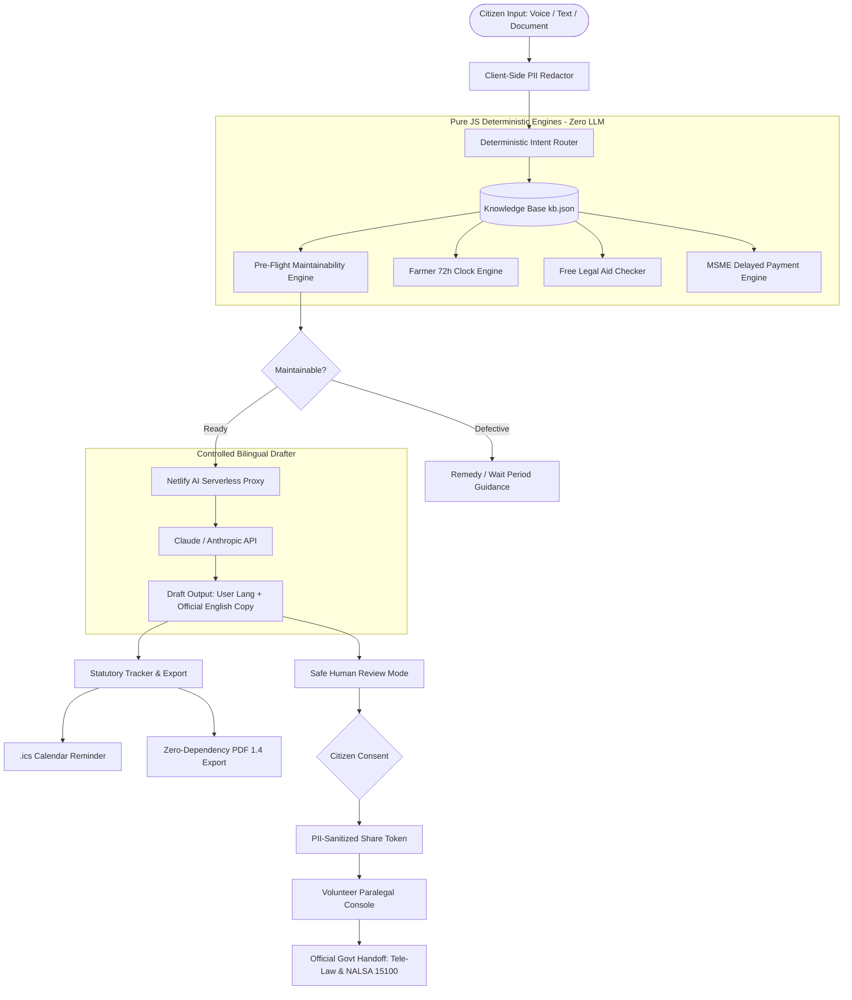

# Haq Saathi: Technical Architecture Specification

## 1. Architectural Philosophy

Traditional "legal AI" chatbots rely on large language models to interpret statutes, calculate interest, and advise on forum selection. In legal systems, this approach causes severe hallucinations, miscalculates strict statutory limitation periods, and fails maintainability screening.

**Haq Saathi's Core Principle:**  
> **"Zero LLM inside deterministic legal engines."**

The LLM is strictly confined to free-text understanding and drafting in citizen vernacular languages. All legal decisions (jurisdictional thresholds, maintainability criteria, statutory wait periods, interest math, and eligibility tests) are executed deterministically in pure JavaScript code.

---

## 2. End-to-End System Architecture

---

## 3. Subsystem Breakdown

### 3.1 PII Sanitization Engine (`src/engine/redact.js`)
- Runs client-side before any network transmission or AI call.
- Uses regex patterns to scrub:
  - 12-digit Aadhaar numbers (`\b[2-9]\d{3}[\s-]?\d{4}[\s-]?\d{4}\b`)
  - 10-character PAN identifiers (`\b[A-Z]{5}[0-9]{4}[A-Z]{1}\b`)
  - Indian mobile numbers (`(?:(?:\+91|91|0)[\s-]?)?[6-9]\d{4}[\s-]?\d{5}\b`)
  - Email addresses
  - 9–18 digit bank account numbers
- Names and physical addresses are preserved per user discretion, with prominent UI notices not to enter unneeded sensitive data.

### 3.2 Pre-Flight Maintainability Rules Engine (`src/engine/preflight.js`)
Addresses the root cause behind 85% of complaints rejected at CRPC screening:
1. **RBI Integrated Ombudsman Clause 10:**
   - Validates prior written complaint to the bank.
   - Enforces 30-day statutory resolution window before ombudsman maintainability.
   - Checks limitation period: within 1 year of bank's rejection (or 1 year 30 days if no reply).
2. **Consumer Protection Act (CPA) 2019 Jurisdiction:**
   - Checks consideration paid (not compensation claimed):
     - District Commission: ≤ ₹50 Lakhs
     - State Commission: > ₹50 Lakhs to ₹2 Crore
     - National Commission: > ₹2 Crore
   - Enforces 2-year limitation period from cause of action.
3. **Police / BNSS 2023 Ladder:**
   - Enforces statutory progression: Local Station (s.173) → SP / DCP (s.173(4)) → Judicial Magistrate (s.175(3)).

### 3.3 Hero Pack Modules (`src/engine/`)
- **`farmer72h.js`:** Calculates exact hours remaining of the mandatory 72-hour window under PMFBY. Identifies localized perils (hailstorm, inundation, post-harvest loss) vs widespread losses requiring area-based assessment.
- **`legalaid.js`:** Implements Section 12 of the Legal Services Authorities Act, 1987. Validates protected categories (women, children, SC/ST, disabled, victims of custody/disaster) who qualify with zero income test, and routes higher-income citizens to Tele-Law.
- **`msme_invoice.js`:** Computes statutory credit period (15 days default, max 45 days under written agreement) and compound interest with monthly rests at exactly 3x the RBI bank rate under MSMED Act Sections 15 & 16. Includes Section 43B(h) Income Tax disallowance notice.

### 3.4 Statutory Tracker & Zero-Dependency PDF Engine (`src/engine/tracker.js` & `pdfExport.js`)
- **RFC 5545 `.ics` Generator:** Generates iCalendar events with standard `VALARM` reminder alerts scheduled 1 day prior to statutory expiry.
- **Pure JavaScript PDF 1.4 Generator:** Generates valid PDF 1.4 documents without native binaries or heavy npm dependencies. Computes byte offsets, xref cross-reference tables, text formatting, and statutory disclaimers.

### 3.5 Volunteer Reviewer Console (`src/engine/reviewer.js`)
- **BCI Rule 36 Compliance:** Strictly prohibits advocate listings, ratings, prices, or fee commissions.
- **Simulated Volunteer Audit:** Badged as `SIMULATED (demo) - Volunteer Reviewer Mode`.
- **Factual Grounding Score:** Evaluates citizen claims against uploaded evidence and computes percentage of grounded claims.
- **Government Redressal Handoff:** Directs citizens to official Tele-Law (tele-law.in) and NALSA toll-free helpline (15100).

---

## 4. Multilingual & Accessibility Layer

- **Tier 1 (100% Tested):** English, Hindi, Telugu.
- **Tier 2 (Beta):** Urdu (with dynamic `dir="rtl"` support), Marathi, Tamil.
- **Voice AI:** Web Speech API integration mapping BCP-47 codes (`en-IN`, `hi-IN`, `te-IN`, `ur-IN`, `mr-IN`, `ta-IN`) with typing fallback.
- **Offline Resilience:** Cached demo responses for all 4 hero flows guarantee 100% reliability during live hackathon demonstrations even in zero-connectivity environments.
